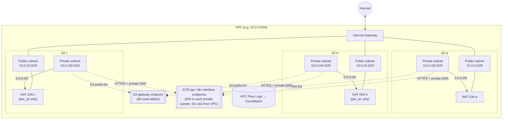

# terraform-aws-multi-az-vpc

[](../../actions/workflows/ci.yml)


A reusable, production-ready Terraform module that provisions a **multi-AZ AWS VPC** with public and private subnets, NAT gateways, and **VPC endpoints for S3 and ECR**. It works in any AWS region and is parameterised for `dev`, `stage` and `prod` environments.

> **Code Clinic – Challenge #1 (Cloud Infrastructure & Provisioning).**
> *Write a Terraform module that provisions a multi-AZ VPC with public/private subnets, NAT gateways, and VPC endpoints for S3/ECR, parameterised for any AWS region and environment (dev/stage/prod).*

---

## Table of contents

- [Features](#features)
- [Architecture](#architecture)
- [Prerequisites](#prerequisites)
- [Quick start](#quick-start)
- [Usage examples](#usage-examples)
- [Environment defaults](#environment-defaults)
- [Subnet layout](#subnet-layout)
- [Inputs](#inputs)
- [Outputs](#outputs)
- [Security considerations](#security-considerations)
- [Idempotency notes](#idempotency-notes)
- [Cost considerations](#cost-considerations)
- [Testing](#testing)
- [CI pipeline](#ci-pipeline)
- [Repository layout](#repository-layout)
- [Required IAM permissions](#required-iam-permissions)

---

## Features

| Capability | Details |
|---|---|
| **Multi-AZ** | 2–6 AZs, picked automatically (sorted, opt-in zones excluded) or passed explicitly. |
| **Public subnets** | One per AZ, shared route table with a default route to the Internet Gateway. |
| **Private subnets** | One per AZ, **one route table per AZ**, so you can switch to per-AZ NAT without re-architecting. |
| **NAT gateways** | `per_az` (HA), `single` (cheap) or `none` (fully private). The default comes from the environment. |
| **VPC endpoints** | S3 **gateway** endpoint on every route table, plus **interface** endpoints for `ecr.api` and `ecr.dkr` (you can add `logs`, `sts`, `ssm`, and so on). |
| **Any region / partition** | Endpoint service names are looked up through `aws_vpc_endpoint_service`; nothing is hard-coded. |
| **Security baseline** | Default SG locked down (CIS 5.4), VPC Flow Logs (CIS 3.9), no auto-assigned public IPs, least-privilege endpoint SG and flow-log IAM role. |
| **Deterministic CIDRs** | Subnets are computed from the VPC CIDR with stable indexes, or you can supply them explicitly. |
| **Tested** | `terraform test` suite with a mocked AWS provider (no credentials needed) plus fmt, validate, TFLint and Checkov in CI. |

## Architecture



**Traffic flow from a private workload pulling a container image:**

1. `docker pull <acct>.dkr.ecr.<region>.amazonaws.com/app:1.0`: private DNS on the `ecr.api` and `ecr.dkr` endpoints resolves to private IPs inside the VPC.
2. Image layers are served from S3 and travel through the **S3 gateway endpoint** (no NAT data-processing charges).
3. Everything else that leaves the VPC goes out through the NAT gateway in the same AZ (`per_az`) or the shared one (`single`).

## Prerequisites

| Tool | Version |
|---|---|
| [Terraform](https://developer.hashicorp.com/terraform/install) | `>= 1.7` (1.7 is required for `mock_provider` in tests) |
| AWS provider | `>= 5.0, < 7.0` |
| AWS credentials | A profile, SSO session or OIDC role with the [permissions below](#required-iam-permissions) |
| Optional | [TFLint](https://github.com/terraform-linters/tflint), [Checkov](https://www.checkov.io/), [pre-commit](https://pre-commit.com/) |

## Quick start

```bash
git clone <this-repo> && cd terraform-aws-multi-az-vpc/examples/complete

# (optional) configure remote state
cp backend.tf.example backend.tf   # edit bucket/key/region

terraform init
terraform plan  -var-file=env/dev.tfvars -out=dev.tfplan
terraform apply dev.tfplan
```

To deploy another environment or region, change the var file (and the state key):

```bash
terraform init -reconfigure -backend-config="key=network/prod/terraform.tfstate"
terraform apply -var-file=env/prod.tfvars
```

Clean up with `terraform destroy -var-file=env/dev.tfvars`.

## Usage examples

### Minimal

```hcl
provider "aws" {
  region = "us-east-1"
}

module "vpc" {
  source = "git::https://github.com/<org>/terraform-aws-multi-az-vpc.git?ref=v1.0.0"

  name        = "payments"
  environment = "dev"
}
```

This creates 3 AZs, `10.0.0.0/16`, a single NAT gateway, S3 + ECR endpoints and flow logs.

### Production, EKS-ready, extra endpoints

```hcl
module "vpc" {
  source = "git::https://github.com/<org>/terraform-aws-multi-az-vpc.git?ref=v1.0.0"

  name        = "payments"
  environment = "prod"           # -> nat_gateway_mode = "per_az"
  vpc_cidr    = "10.30.0.0/16"
  az_count    = 3

  interface_endpoints   = ["ecr.api", "ecr.dkr", "logs", "sts", "ssm"]
  flow_logs_kms_key_arn = aws_kms_key.logs.arn

  public_subnet_tags  = { "kubernetes.io/role/elb" = "1" }
  private_subnet_tags = { "kubernetes.io/role/internal-elb" = "1" }

  tags = { DataClassification = "confidential" }
}
```

### Fully private (no internet egress)

```hcl
module "vpc" {
  source = "../.."

  name             = "analytics"
  environment      = "prod"
  nat_gateway_mode = "none"
  interface_endpoints = ["ecr.api", "ecr.dkr", "logs", "sts", "secretsmanager"]
}
```

### Explicit AZs and CIDRs (for IPAM-managed address space)

```hcl
module "vpc" {
  source = "../.."

  name                 = "legacy"
  environment          = "stage"
  vpc_cidr             = "10.50.0.0/16"
  azs                  = ["eu-west-1a", "eu-west-1b"]
  public_subnet_cidrs  = ["10.50.0.0/24", "10.50.1.0/24"]
  private_subnet_cidrs = ["10.50.10.0/23", "10.50.12.0/23"]
}
```

A complete, runnable root module with `dev` / `stage` / `prod` var files is in [`examples/complete`](examples/complete).

## Environment defaults

| Setting | dev | stage | prod |
|---|---|---|---|
| `nat_gateway_mode` (when null) | `single` | `single` | `per_az` |
| Example AZs (`env/*.tfvars`) | 2 | 3 | 3 |
| Example flow log retention | 30 days | 90 days | 365 days |
| Example interface endpoints | ecr.api, ecr.dkr | + logs | + logs, sts |

Each setting can be overridden on its own.

## Subnet layout

With the defaults (`vpc_cidr = 10.0.0.0/16`, `subnet_newbits = 4`), the VPC is cut into sixteen `/20` blocks (4,091 usable IPs each). The **lower half is public** and the **upper half is private**:

| Index | AZ | Public subnet | Private subnet (index + 8) |
|---|---|---|---|
| 0 | a | `10.0.0.0/20` | `10.0.128.0/20` |
| 1 | b | `10.0.16.0/20` | `10.0.144.0/20` |
| 2 | c | `10.0.32.0/20` | `10.0.160.0/20` |
| 3–7 | spare | free for future AZs / tiers | free |

Each AZ's position is fixed, so **adding an AZ later never renumbers existing subnets**. Set `subnet_newbits` for different sizes (for example 6 → `/22`), or pass `public_subnet_cidrs` / `private_subnet_cidrs` explicitly.

## Inputs

| Name | Description | Type | Default |
|---|---|---|---|
| `name` | Workload name; resource prefix (`<name>-<environment>-…`). | `string` | **required** |
| `environment` | `dev`, `stage` or `prod`. | `string` | **required** |
| `tags` | Extra tags for every resource. | `map(string)` | `{}` |
| `vpc_cidr` | VPC CIDR (/16 – /24). | `string` | `"10.0.0.0/16"` |
| `az_count` | Number of AZs (2–6), used when `azs` is empty. | `number` | `3` |
| `azs` | Explicit AZ names. | `list(string)` | `[]` |
| `subnet_newbits` | Bits added to the VPC prefix for each subnet (3–8). | `number` | `4` |
| `public_subnet_cidrs` | Explicit public CIDRs, one per AZ. | `list(string)` | `[]` |
| `private_subnet_cidrs` | Explicit private CIDRs, one per AZ. | `list(string)` | `[]` |
| `map_public_ip_on_launch` | Auto-assign public IPs in public subnets. | `bool` | `false` |
| `public_subnet_tags` | Extra tags for public subnets. | `map(string)` | `{}` |
| `private_subnet_tags` | Extra tags for private subnets. | `map(string)` | `{}` |
| `nat_gateway_mode` | `per_az`, `single`, `none`, or `null` (environment default). | `string` | `null` |
| `enable_s3_gateway_endpoint` | Create the S3 gateway endpoint. | `bool` | `true` |
| `s3_endpoint_policy` | JSON policy for the S3 endpoint. | `string` | `null` |
| `interface_endpoints` | Interface endpoint service short names. | `list(string)` | `["ecr.api", "ecr.dkr"]` |
| `interface_endpoint_policy` | JSON policy for interface endpoints. | `string` | `null` |
| `manage_default_security_group` | Strip all rules from the default SG. | `bool` | `true` |
| `enable_flow_logs` | Enable VPC Flow Logs to CloudWatch. | `bool` | `true` |
| `flow_logs_traffic_type` | `ACCEPT`, `REJECT` or `ALL`. | `string` | `"ALL"` |
| `flow_logs_retention_days` | Log retention (CloudWatch-supported value). | `number` | `365` |
| `flow_logs_kms_key_arn` | KMS key for the flow log group. | `string` | `null` |

## Outputs

| Name | Description |
|---|---|
| `vpc_id`, `vpc_cidr_block` | VPC identifiers |
| `azs` | AZs used, in order |
| `public_subnet_ids`, `private_subnet_ids` | Subnet IDs ordered like `azs` |
| `public_subnets_by_az`, `private_subnets_by_az` | `az => { id, cidr_block }` maps |
| `internet_gateway_id` | IGW ID |
| `public_route_table_id`, `private_route_table_ids` | Route tables |
| `nat_gateway_mode`, `nat_gateway_ids`, `nat_public_ips` | NAT details (EIPs are handy for partner allow-lists) |
| `s3_gateway_endpoint_id`, `interface_endpoint_ids`, `endpoints_security_group_id` | Endpoint details |
| `flow_log_id`, `flow_log_group_name` | Flow log details |

## Security considerations

- **No public IPs by default:** `map_public_ip_on_launch = false`, even in public subnets. Put load balancers in public subnets and keep workloads private.
- **Default security group neutralised:** all its ingress and egress rules are removed (CIS AWS Foundations 5.4), so nothing can rely on it by accident.
- **VPC Flow Logs enabled by default** (CIS 3.9), with 365-day retention and optional KMS encryption via `flow_logs_kms_key_arn`.
- **Least-privilege flow-log role:** it can only write to its own log group, and its trust policy includes an `aws:SourceAccount` condition against the confused-deputy problem.
- **Interface endpoint SG:** inbound TCP 443 from the VPC CIDR only, with no egress rules.
- **Private traffic to AWS services:** ECR and S3 traffic never crosses the internet. Tighten it further with `s3_endpoint_policy` / `interface_endpoint_policy`, for example restricting S3 to your organisation with `aws:PrincipalOrgID` or to specific buckets.
- **Network ACLs** are left at the AWS default (allow all) on purpose. Security groups are the primary control; add NACLs only if your compliance framework requires them.
- **No secrets** are stored or produced by this module. State still contains resource metadata, so use an encrypted S3 backend with locking (see `backend.tf.example`).
- **Static analysis:** Checkov and TFLint run on every PR. The few Checkov skips are justified inline with `#checkov:skip=` comments.

## Idempotency notes

- **Re-running `apply` is safe.** Every resource is declarative, and a second apply with the same inputs reports *No changes*.
- **`for_each` keyed by AZ name** (not `count`), so adding or removing an AZ only touches that AZ's resources and never shifts the others.
- **Stable CIDR indexes:** each AZ keeps the same subnet slot, so there are no forced replacements when `az_count` grows.
- **Deterministic AZ selection:** discovered AZs are sorted before slicing, so the same region always gives the same AZs.
- **Switching NAT modes** (`single` → `per_az`) adds NAT gateways and updates routes in place; subnets and route tables are not replaced.
- **`create_before_destroy` + `name_prefix`** on the endpoint security group lets it be replaced without downtime or name clashes.
- **Changing `vpc_cidr` *does* replace the VPC.** This is an AWS constraint. To extend address space, add secondary CIDRs outside this module.

## Cost considerations

| Item | Approx. cost (us-east-1) | Notes |
|---|---|---|
| NAT gateway | ~$0.045/h each + $0.045/GB processed | `per_az` × 3 ≈ $100/month before data |
| Interface endpoint | ~$0.01/h **per AZ** + $0.01/GB | 2 endpoints × 3 AZs ≈ $44/month |
| S3 gateway endpoint | **Free** | Also cuts NAT data charges for S3/ECR layers |
| Public IPv4 (EIP) | $0.005/h each | One per NAT gateway |
| Flow logs | CloudWatch ingestion + storage | Use `REJECT` or shorter retention in dev |

Use `nat_gateway_mode = "single"` and `az_count = 2` for dev to cut cost. Check current prices on the AWS pricing pages.

## Testing

Tests use Terraform's native test framework with a **mocked AWS provider**, so they need **no AWS account or credentials** and create nothing.

```bash
terraform init -backend=false
terraform test            # or: make test
```

[`tests/vpc.tftest.hcl`](tests/vpc.tftest.hcl) covers:

- the default layout (3 AZs, sorted AZs, CIDR math, single NAT in dev, endpoints, DNS flags, flow logs, tagging/naming)
- `prod` → NAT per AZ, and `none` → no NAT, EIPs or default routes
- explicit AZs, custom `vpc_cidr` / `subnet_newbits`, explicit subnet CIDRs
- every optional feature turned off
- a full mocked `apply` that checks the outputs
- guard rails: invalid environment, a single AZ, a bad CIDR, a bad NAT mode, mismatched subnet lists

For an end-to-end check against a real sandbox account, run `examples/complete` with `env/dev.tfvars`, then `terraform plan` again to confirm *No changes*, then `destroy`.

## CI pipeline

`.github/workflows/ci.yml` runs on every push to `main` and on every pull request:

| Job | What it checks |
|---|---|
| **Format & validate** | `terraform fmt -check -recursive`, plus `terraform validate` on the module and on `examples/complete` |
| **TFLint** | Terraform best-practice rules (naming, documented variables/outputs, standard module structure) and the AWS ruleset |
| **Security scan** | Checkov static analysis of all Terraform |
| **terraform test** | The mocked test suite on Terraform 1.7.5 and 1.9.x |

Run the same checks locally:

```bash
make all          # fmt-check, validate, lint, security, test
pre-commit install  # run fmt/validate/tflint/gitleaks on every commit
```

## Repository layout

```
.
├── main.tf                 # VPC, IGW, subnets, route tables, NAT
├── endpoints.tf            # S3 gateway + interface endpoints, endpoint SG
├── flow_logs.tf            # Flow logs, log group, IAM role
├── variables.tf            # Inputs with validation
├── outputs.tf              # Outputs
├── versions.tf             # Terraform / provider constraints
├── examples/
│   └── complete/           # Runnable root module
│       ├── main.tf  variables.tf  outputs.tf  versions.tf
│       ├── backend.tf.example
│       └── env/{dev,stage,prod}.tfvars
├── tests/
│   └── vpc.tftest.hcl      # Mocked unit tests
├── .github/workflows/ci.yml
├── .tflint.hcl  .checkov.yaml  .pre-commit-config.yaml
├── Makefile
└── CHANGELOG.md  LICENSE
```

## Required IAM permissions

The identity running Terraform needs, at minimum:

- `ec2:*Vpc*`, `ec2:*Subnet*`, `ec2:*RouteTable*`, `ec2:*Route`, `ec2:*InternetGateway*`, `ec2:*NatGateway*`, `ec2:AllocateAddress`, `ec2:ReleaseAddress`, `ec2:DescribeAddresses*`, `ec2:*SecurityGroup*`, `ec2:*VpcEndpoint*`, `ec2:*FlowLogs*`, `ec2:DescribeAvailabilityZones`, `ec2:CreateTags`, `ec2:DeleteTags`
- `logs:CreateLogGroup`, `logs:DeleteLogGroup`, `logs:PutRetentionPolicy`, `logs:DescribeLogGroups`, `logs:TagResource`, `logs:ListTagsForResource`, `logs:AssociateKmsKey`
- `iam:CreateRole`, `iam:DeleteRole`, `iam:GetRole`, `iam:PutRolePolicy`, `iam:GetRolePolicy`, `iam:DeleteRolePolicy`, `iam:TagRole`, `iam:PassRole` (for the flow-log role), `iam:ListRolePolicies`, `iam:ListAttachedRolePolicies`, `iam:ListInstanceProfilesForRole`
- `sts:GetCallerIdentity`

In CI/CD, prefer short-lived credentials (GitHub OIDC → IAM role) over static access keys.

## License

[MIT](LICENSE)
